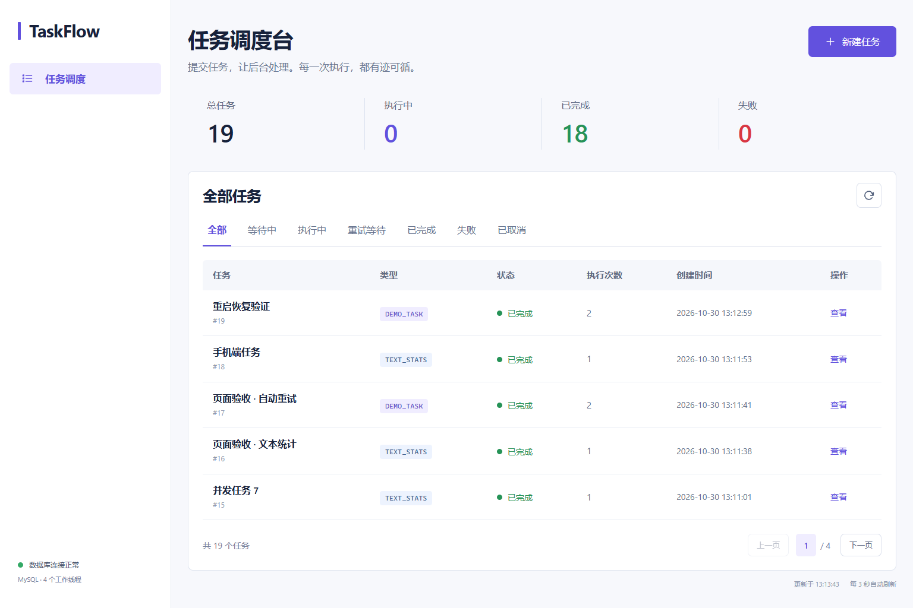
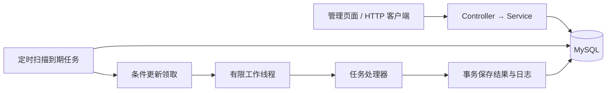

# TaskFlow · Java 异步任务调度系统

[](https://github.com/baihuchen554-cell/taskflow-java-async-scheduler/actions/workflows/ci.yml)
[](pom.xml)
[](LICENSE)

一个可以运行、演示和阅读源码的轻量任务调度系统。提交任务后，接口返回任务编号，后台线程池随后执行；任务状态与执行记录保存到 MySQL，页面自动刷新进度。

项目刻意保持单体结构：**Spring Boot + JDBC + MySQL + 原生 HTML/CSS/JavaScript**。不需要先学习消息队列、微服务或前端框架，就能读懂完整流程。

[快速体验](#快速体验无需-mysql) · [MySQL 运行](#本机-mysql-版windows) · [接口说明](docs/api.md) · [学习指南](docs/learning-guide.md)



实际 MySQL 环境运行截图。更多：[任务详情与重试记录](docs/images/task-detail.png) · [移动端布局](docs/images/mobile.png)。

## 能做什么

- 提交立即执行或指定时间执行的任务。
- 使用有并发上限的线程池，避免请求线程一直等待任务完成。
- 查询任务列表、状态统计、执行结果和每次执行记录。
- 失败后按配置自动重试；重试用完后支持手动重试。
- 取消尚未执行的任务，包括等待重试的任务。
- 保存任务到数据库，并在应用重新启动后恢复未完成的执行。
- 提供中文管理页面，方便直接演示完整流程。

内置两种任务：

| 任务类型 | 用途 |
| --- | --- |
| `TEXT_STATS` | 对输入文字做字符、词数、行数统计，演示有实际结果的异步任务 |
| `DEMO_TASK` | 等待指定秒数，可设置前几次故意失败，演示状态流转和重试 |

## 技术栈与结构

| 层次 | 选型 | 职责 |
| --- | --- | --- |
| 应用 | Java 17 编译目标、Spring Boot 3.5.16 | HTTP 接口、参数校验、事务与配置 |
| 调度 | `@Scheduled`、`ThreadPoolTaskExecutor`、`Semaphore` | 周期扫描、限制并发、异步执行 |
| 数据 | MySQL 8.4、Spring JDBC | 持久化任务、条件领取、保存执行记录 |
| 页面 | 原生 HTML / CSS / JavaScript | 创建、筛选、轮询、详情与状态操作 |
| 测试 | JUnit 5、Spring Boot Test、H2 | 接口与调度持久化逻辑测试 |
| 构建 | Maven Wrapper、Docker Compose | 依赖管理、打包与应用/数据库启动 |



请求线程只负责校验并落库；调度器负责领取；工作线程负责执行。默认最多同时执行 `4` 个任务，扫描间隔 `1` 秒，失败后等待 `5` 秒重试。未领取的任务留在数据库，线程池不设置内存等待队列。

## 快速体验：无需 MySQL

下载或克隆仓库后，在项目根目录执行。需要已安装 **JDK 17–25，推荐 JDK 21**；Maven Wrapper 会下载 Maven 和项目依赖，无需手动安装 Maven。

```bash
git clone https://github.com/baihuchen554-cell/taskflow-java-async-scheduler.git
cd taskflow-java-async-scheduler
```

Windows PowerShell：

```powershell
powershell -ExecutionPolicy Bypass -File .\scripts\start-demo.ps1
```

macOS / Linux（先将 `JAVA_HOME` 指向兼容的 JDK）：

```bash
bash ./mvnw spring-boot:run -Dspring-boot.run.profiles=demo
```

看到启动完成后，访问 **[http://localhost:8080](http://localhost:8080)**，按 `Ctrl+C` 停止应用。该模式使用 H2 文件数据库，数据位于 `data` 目录，方便体验功能；验证 MySQL 集成时使用下面的 MySQL 运行方式。

## 本机 MySQL 版（Windows）

在本项目文件夹打开 PowerShell：

```powershell
powershell -ExecutionPolicy Bypass -File .\scripts\start-local.ps1
```

该脚本使用本机安装的 MySQL 8.4 程序，在项目 `.local` 目录创建独立的数据目录并使用端口 `3308`，与已有 MySQL 服务分开。脚本会选择已安装的兼容 JDK，Maven Wrapper 会准备 Maven；首次运行需要联网下载构建依赖。

项目路径含中文时，脚本会在 `%LOCALAPPDATA%/TaskFlow` 下创建英文路径连接，实际数据仍保存在项目的 `.local` 中。

看到 Spring Boot 启动完成后，在浏览器打开 **[http://localhost:8080](http://localhost:8080)**。终端保持打开，按 `Ctrl+C` 停止应用。

演示结束后，也可以停止项目独立的 MySQL 进程，数据仍会保留：

```powershell
powershell -ExecutionPolicy Bypass -File .\scripts\stop-local.ps1
```

其他电脑需安装 JDK 17–25（推荐 JDK 21）和 MySQL 8.4。MySQL 安装位置不同可以传入 `-MySqlHome '你的 MySQL 安装目录'`；应用端口被占用可以传入 `-Port 8081`。

MySQL 与 H2 演示模式不要同时占用同一个应用端口。

## 使用已有 MySQL

1. 使用 MySQL 管理员账号执行 `scripts/init-db.sql`，创建 `taskflow` 数据库和仅用于该数据库的账号。先修改脚本中的示例密码。
2. 在 PowerShell 中配置连接信息并启动：

```powershell
$env:DB_URL = 'jdbc:mysql://localhost:3306/taskflow?connectionTimeZone=UTC&forceConnectionTimeZoneToSession=true'
$env:DB_USERNAME = 'taskflow'
$env:DB_PASSWORD = '你在初始化脚本中设置的密码'
. .\scripts\java-env.ps1
.\mvnw.cmd spring-boot:run
```

应用首次连接时会自动创建任务表和执行记录表。项目编译目标是 Java 17，推荐使用 JDK 21；本项目 Spring Boot 版本为 `3.5.16`，本地脚本会选择兼容的 JDK。

## 使用 Docker Compose

已安装并启动 Docker 的电脑可以同时运行 MySQL 和应用：

```powershell
Copy-Item .env.example .env
# 打开 .env，设置数据库密码。
docker compose up --build -d
docker compose logs -f app
```

macOS / Linux 将第一行替换为 `cp .env.example .env`，其余 Docker 命令相同。

访问 [http://localhost:8080](http://localhost:8080)。应用端口默认为 `8080`，数据库映射到本机 `3307`；可在 `.env` 中修改。数据库内容保存在 Docker 命名卷中。

```powershell
docker compose down
```

上述停止命令会保留数据库卷，再次启动后仍能看到任务。

## 两分钟演示

1. 打开页面，点击“新建任务”。
2. 创建一个文本统计任务，输入一段文字。观察任务进入执行成功状态，打开详情查看统计结果。
3. 再创建一个演示任务：等待 `2` 秒、前 `1` 次失败、最多重试 `2` 次。观察“执行中 → 等待重试 → 执行中 → 成功”，详情中会保留失败和成功两次记录。
4. 创建一个一分钟后执行的任务，在执行前取消，确认它变为“已取消”。
5. 刷新页面或重新启动应用，查看数据库中保存的任务记录。

## 运行测试与打包

```powershell
powershell -ExecutionPolicy Bypass -File .\scripts\test.ps1

# 在当前 PowerShell 会话选择兼容 JDK 后打包：
. .\scripts\java-env.ps1
.\mvnw.cmd package
```

测试使用独立的测试数据库配置，不需要提供个人 MySQL 密码。打包产物位于 `target/taskflow-1.0.0.jar`；运行它需要兼容的 Java 运行时和数据库连接配置。

macOS / Linux 可执行 `bash ./mvnw test` 和 `bash ./mvnw package`。

测试覆盖文本执行、自动重试、重试预算与手动重试、延迟取消、运行中非法操作、并发提交、参数校验、分页统计，以及条件领取竞争、中断恢复、拒绝提交后的重新排队。自动化测试使用 H2 的 MySQL 兼容模式；这不能替代真实 MySQL 环境的集成检查。

MySQL 版应用启动后，可运行跨平台的真实接口检查：

```bash
python scripts/smoke_test.py --require-mysql
```

该脚本仅依赖 Python 标准库，会向当前数据库写入演示任务；请用于开发数据库。Linux / macOS 可使用 `python3`，端口不同时增加 `--base-url http://127.0.0.1:8081`。

### 已完成的本地验证

验证日期：**2026-10-30**。环境：Windows 11、JDK 24.0.1、MySQL 8.4.10。

| 检查 | 结果 |
| --- | --- |
| Maven `verify` | 12 项测试通过，0 失败、0 错误，完成打包 |
| 真实 MySQL 接口检查 | 文本统计、自动重试、手动重试、延迟取消通过 |
| 8 个并发 HTTP 请求 | 每个任务均成功，正常运行中各保留 1 次执行记录 |

[GitHub Actions 工作流](.github/workflows/ci.yml)会执行 Maven 验证、JavaScript 语法检查及 MySQL 8.4 接口检查；远程执行状态以页面顶部的 CI 徽章为准。本地结果不代表已经完成负载测试。

## 目录导航

```text
src/main/java/com/example/taskflow/
├── api/             # HTTP 接口、请求校验、统一错误响应
├── config/          # 调度参数、线程池和时钟
├── model/           # 任务、执行记录与状态枚举
├── repository/      # 显式 SQL 与数据库映射
└── service/         # 业务操作、调度器、工作线程、任务处理器
src/main/resources/
├── application.yml  # 默认 MySQL 配置
├── application-demo.yml
├── schema.sql       # 建表语句和索引
└── static/          # 中文管理页面，无前端构建步骤
src/test/            # 接口与持久化逻辑测试
scripts/             # Windows 运行脚本、数据库初始化、跨平台接口检查
docs/                # 接口、学习和项目展示说明
```

## 常用配置

配置文件是 `src/main/resources/application.yml`，以下环境变量可以覆盖默认值：

| 环境变量 | 默认值 | 说明 |
| --- | --- | --- |
| `SERVER_PORT` | `8080` | 应用端口 |
| `SERVER_ADDRESS` | `127.0.0.1` | 监听地址 |
| `SCHEDULER_WORKERS` | `4` | 最大并发工作线程数，范围 `1..32` |
| `SCHEDULER_POLL_INTERVAL_MS` | `1000` | 扫描间隔，毫秒，至少 `100` |
| `SCHEDULER_RETRY_DELAY_SECONDS` | `5` | 失败后的固定等待秒数，范围 `1..3600` |
| `DB_URL` / `DB_USERNAME` / `DB_PASSWORD` | 见配置文件 | MySQL 连接信息 |

`start-local.ps1` 为项目独立 MySQL 实例设置连接信息和随机密码，保存在本机 `.local/database.json`；不要把这个本地文件加入版本库。

## 先读哪一部分

| 文档 | 内容 |
| --- | --- |
| [学习指南](docs/learning-guide.md) | 用 Python 类比理解 Java、架构、状态机与代码阅读顺序 |
| [接口说明](docs/api.md) | 请求参数、返回结构、错误码与 PowerShell 示例 |
| [简历与面试说明](docs/resume.md) | 可如实使用的项目介绍、演示路线与常见追问 |

## 项目范围

这是**单实例、用于本地学习和展示**的任务调度系统，支持立即任务和指定时间的一次性任务，暂不包含 Cron 周期任务。默认只监听本机。应用重启会恢复中断任务，因此执行语义是“至少一次”：有外部副作用的真实业务需要额外设计幂等性。当前没有登录权限系统，不应直接开放到公网。

若任务执行结束时数据库断线，结果可能无法写回。当前实现会记录错误，需要恢复数据库后重启应用，重新处理遗留的运行中任务。

项目展示重点是可解释的异步流程、数据库状态管理、失败处理和完整的接口/页面联动；没有虚构吞吐量或分布式能力。

## 贡献与许可证

修改前请阅读[贡献说明](CONTRIBUTING.md)。项目采用 [MIT License](LICENSE)。
