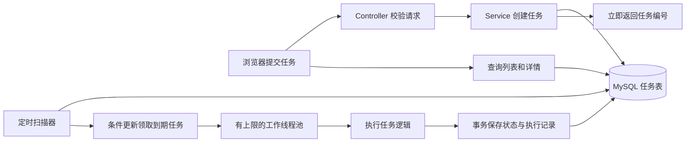
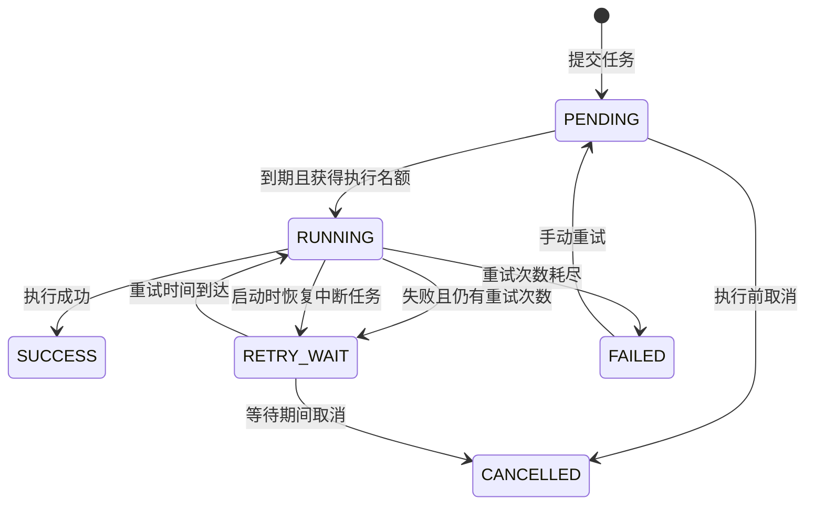

# 从 Python 过渡：读懂这个 Java 项目

你不需要先掌握所有 Java 特性。先能解释“请求如何变成数据库里的任务，谁来执行它，失败之后怎么办”，就抓住了这个项目的核心。

## 建议的学习路线

每一步都以可观察的结果为终点。先把一个流程讲清楚，再继续下一步。

| 阶段 | 动手做什么 | 完成标志 |
| --- | --- | --- |
| 1. 运行与观察 | 启动项目，创建文本统计任务，查看任务详情和执行记录 | 能区分“提交成功”和“执行成功” |
| 2. 接口与类型 | 阅读 `TaskController`、`CreateTaskRequest`、`TaskStatus`，用 PowerShell 或 Python 发一次请求 | 能说明 URL、请求体、Java 字段类型和返回值 |
| 3. 数据库与状态 | 对照 `schema.sql` 和 `TaskRepository`，查询自己创建的任务及日志 | 能解释一张表存当前状态，另一张表存历史尝试 |
| 4. 调度与并发 | 阅读 `TaskDispatcher`、`TaskWorker`，提交多个有等待时间的任务 | 能分清请求线程、扫描线程、工作线程，以及并发上限 |
| 5. 失败与恢复 | 运行前一次失败的演示任务，阅读自动重试和恢复相关测试 | 能解释重试预算、累计次数及至少一次执行的边界 |
| 6. 做一个小改动 | 为文本统计增加一项结果并补充有意义的断言 | 能指出自己改了哪里、为什么、如何验证 |

必需的 Java 基础只有类与方法、构造函数、枚举、泛型集合、异常、Lambda，以及项目里用到的几个注解。`record` 可以先当作不可重新赋值的数据字段集合来读。暂时不必先学习 JVM 调优、反射内部实现、分布式锁或微服务。

## 先建立 Python 对照

| 这里的概念 | Python 中的近似理解 | 需要注意的差异 |
| --- | --- | --- |
| Spring Boot | 帮你装配服务的 Web 应用框架 | 它也负责创建对象、配置数据库和管理线程池 |
| `@RestController` | Flask/FastAPI 的接口模块 | 标注在类上，让该类的方法处理 HTTP 请求 |
| `@GetMapping` / `@PostMapping` | `@app.get` / `@app.post` | 把 URL 和处理方法关联起来 |
| Java `record` | 主要用于传输数据的 `dataclass` | 字段不可重新赋值，适合请求和返回数据 |
| 构造函数注入 | 把数据库、服务对象作为参数传入 | Spring 自动提供这些依赖，业务代码少写 `new` |
| `JdbcTemplate` | 封装了连接和游标处理的数据库访问工具 | SQL 仍然明确写在代码里，参数使用占位符绑定 |
| `ThreadPoolTaskExecutor` | `concurrent.futures.ThreadPoolExecutor` | Spring 管理其启动、任务提交和关闭 |
| `@Scheduled` | 周期性执行的调度回调 | 本项目用它扫描数据库，真正的任务交给工作线程 |
| 数据库事务 | `with connection:` 中的一组提交 | 任务状态和日志需要一起成功或一起回滚 |
| Maven / `pom.xml` | 依赖管理加构建工具 | 类似依赖清单与构建命令的组合，不能完全等同于 pip |

这里的异步实现使用工作线程，不是 Python `asyncio` 那样的协程事件循环。演示任务里的 `Thread.sleep` 会占用一个工作线程，但不会占住提交任务的 HTTP 请求。不要把 Java 中的“异步”一概理解为 `async def`。

## 一个请求会经过什么



**异步不等于执行得更快。** 它表示提交任务的 HTTP 请求不必等任务完成。多个任务可以在并发上限内同时运行，而超出的任务继续保存在数据库里等待领取。

**任务保存在数据库里，是这里和简单 `@Async` 示例的关键区别。** 仅把一个方法扔进内存线程池，进程退出时内存中等待的任务可能丢失。本项目先入库再执行，重启后可以继续扫描未完成任务。

## 任务状态机



`maxRetries=2` 表示初次执行之外最多再自动重试两次，一轮最多尝试三次。`attempts` 表示累计实际执行次数；手动重试会开启新的重试预算，但不会清空历史执行次数或日志。

取消操作只针对 `PENDING` 和 `RETRY_WAIT`。正在执行的 Java 方法可能已经产生结果，本项目没有把“修改状态为取消”当成“线程一定已经停止”，因此不提供运行中强制取消。

## 三个值得理解的设计

### 1. 为什么领取任务要用条件更新

如果先查询到一个待执行任务，再无条件把它改成运行中，两次扫描可能都拿到它。解决方法是把“只有仍待执行才允许领取”放进 SQL 的 `WHERE` 条件，只有影响行数为 `1` 的调用才算领取成功。

示意 SQL，不是完整源码：

```sql
UPDATE tasks
SET status = 'RUNNING'
WHERE id = ?
  AND status IN ('PENDING', 'RETRY_WAIT')
  AND next_run_at <= ?;
```

查询是为了找到候选，条件更新才是最后的领取判定。数据库事务还会把“领取任务”和“创建本次执行记录”放在同一组提交中。

这并不自动让项目成为分布式调度器。启动恢复逻辑假设只有一个应用实例运行；多个实例还需要租约、心跳和明确的任务归属。

### 2. 为什么线程池不能无限接收任务

线程过多会占用内存并造成调度开销，内存队列无限增长也可能耗尽资源。本项目限制并发量，把尚未领取的任务留在数据库里。

扫描器负责调度，工作线程负责耗时操作，两者分开后，一个任务等待几秒不会阻塞所有其他任务的扫描。任务完成后释放执行名额，下一轮扫描再领取新的任务。

线程池在关闭等情况下仍可能拒绝提交，因此调度器需要处理“数据库已经领取，但线程池没有接收”的情况，避免任务永久停留在运行中。

### 3. 为什么重试不等于绝对可靠

假设任务是调用外部系统发送通知：外部通知已经发送成功，应用却在写回成功状态前退出。重启后再执行，就可能发送第二次。

因此本项目承诺的是“至少一次执行”，不是“恰好执行一次”。真实业务可以把任务编号作为幂等键，让外部系统或本地业务表识别重复请求。没有外部系统配合，不能仅靠调度器宣称完全避免重复副作用。

当前重试采用固定间隔，适合看清楚流程。后续可以再学习指数退避、随机抖动、死信处理和告警。

## 阅读代码的顺序

1. 先看 [application.yml](../src/main/resources/application.yml)：理解数据库连接、线程数、扫描和重试间隔。
2. 再看 [schema.sql](../src/main/resources/schema.sql)：`tasks` 保存当前状态，`task_logs` 保存每次尝试的历史。
3. 找到 [api/TaskController.java](../src/main/java/com/example/taskflow/api/TaskController.java) 和同目录的 `CreateTaskRequest.java`：从创建任务接口看入参、返回值与校验规则。
4. 阅读 [service/TaskService.java](../src/main/java/com/example/taskflow/service/TaskService.java)：看创建、取消和手动重试的业务限制，以及事务的边界。
5. 阅读 [repository/TaskRepository.java](../src/main/java/com/example/taskflow/repository/TaskRepository.java)：观察参数化 SQL、条件更新和任务列表查询。
6. 阅读 [service/TaskDispatcher.java](../src/main/java/com/example/taskflow/service/TaskDispatcher.java)：这是“为什么会自动执行”的核心，追踪扫描、领取和线程池提交的过程。
7. 阅读 [service/TaskWorker.java](../src/main/java/com/example/taskflow/service/TaskWorker.java) 与 [service/TaskHandler.java](../src/main/java/com/example/taskflow/service/TaskHandler.java)：看执行结果如何保存，再比较文本统计与故意失败的演示任务。
8. 最后阅读 `src/test`：看测试如何构造失败、延迟和非法状态，确认边界行为。

第一次阅读不用追进 Spring 内部，只需沿着自己项目中的方法调用往下看。遇到注解，先理解它在当前文件中的作用。

## 用熟悉的 Python 调一次接口

应用启动后，这段脚本仅使用 Python 标准库，提交任务后每秒查询，最多等待 30 秒：

```python
import json
import time
from urllib.request import Request, urlopen

base = "http://localhost:8080"
payload = json.dumps({
    "name": "来自 Python 的文本任务",
    "type": "TEXT_STATS",
    "payload": "Hello Java\nHello async",
}, ensure_ascii=False).encode("utf-8")

request = Request(
    f"{base}/api/tasks",
    data=payload,
    headers={"Content-Type": "application/json; charset=utf-8"},
    method="POST",
)
with urlopen(request, timeout=5) as response:
    task = json.load(response)

for _ in range(30):
    with urlopen(f"{base}/api/tasks/{task['id']}", timeout=5) as response:
        task = json.load(response)
    print(task["id"], task["status"])
    if task["status"] in {"SUCCESS", "FAILED", "CANCELLED"}:
        print(json.loads(task["result"]) if task["result"] else task["lastError"])
        break
    time.sleep(1)
else:
    print("任务尚未结束，请稍后在页面查看。")
```

这也能帮助你理解语言边界：Python 客户端只依赖 HTTP 和 JSON，并不需要理解 Spring 内部。Java 服务则独立负责校验、存储和执行。

## 文本统计的口径

输入 `Hello async` 会得到 `{"characters":11,"words":2,"lines":1}`。`characters` 按 Unicode 码点计数，空格和换行也包含在内；`words` 按空白分隔片段计数，不是中文分词；`lines` 包含结尾换行产生的空行，空字符串三项都为 `0`。

调度器并不关心这些业务细节。它只关心处理器是否返回结果或抛出异常，这使以后增加新的任务类型比较直接。

## 可以自己做的三个小练习

| 练习 | 涉及知识 | 验收方式 |
| --- | --- | --- |
| 给文本统计结果增加“去空白字符数” | 字符串处理、结果序列化 | 输入含空格和换行的文本，核对结果 |
| 增加一种返回大写文本的任务 | 枚举、分支、请求校验、页面表单 | 新任务可提交、查询和显示结果 |
| 将固定重试间隔改为指数退避 | 时间计算、测试、失败处理 | 对照日志确认每次等待时间按预期增加 |

做完并能解释其中一个练习，比背诵更多技术名词更能体现你真正理解了项目。
